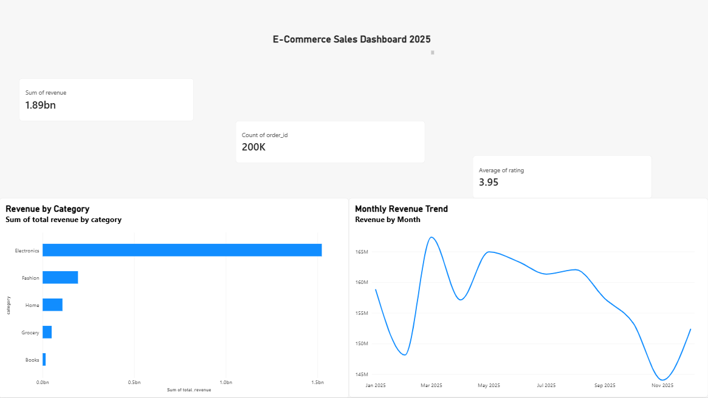
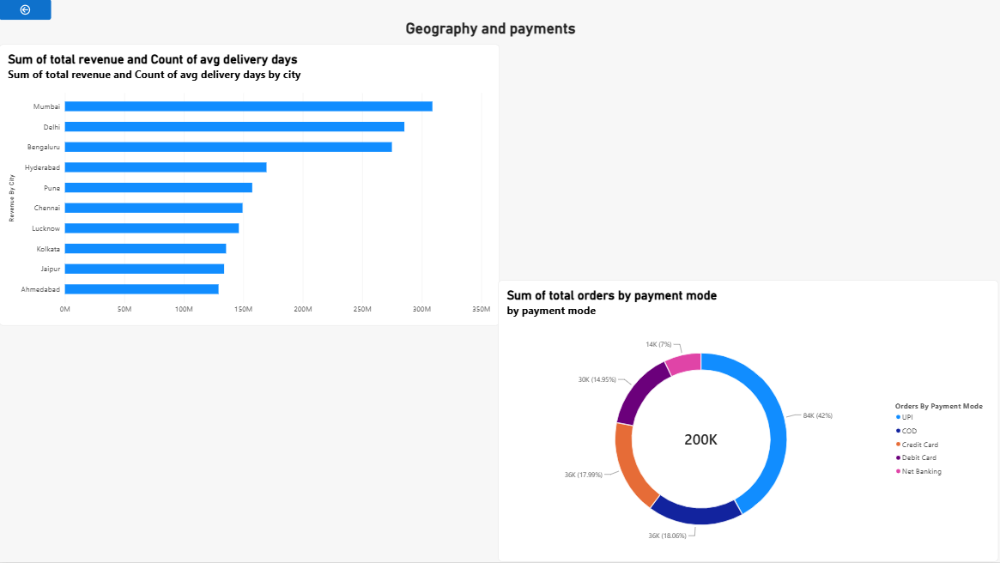
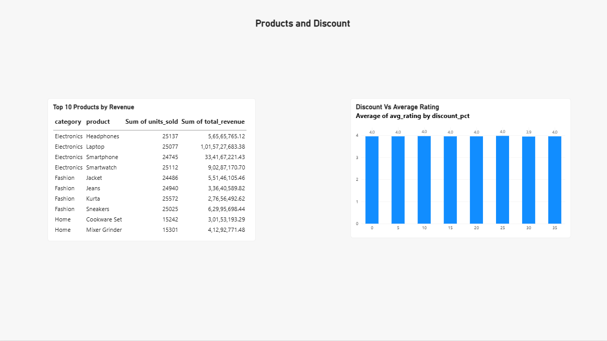

# Big Data Analytics: E-Commerce Sales with Apache Hive and Power BI

Analysis of 200,000 e-commerce orders (India, 2025) using Apache Hive for querying and Power BI for a 3-page dashboard.

> **Note:** The dataset is **synthetic**, generated with Python for this project. Findings describe the generated data, not real market behaviour.

## Tech Stack

- Apache Hive 4.0.0 (Docker, `apache/hive:4.0.0`) with Beeline
- Partitioned ORC tables
- Power BI Desktop
- Python (pandas, NumPy) for data generation

## Repository Contents

| File | Description |
|---|---|
| `sales_data.csv` | Synthetic dataset, 200,000 orders, 13 columns |
| `hive_queries.hql` | Database and table creation (raw text table and partitioned ORC table) plus 6 analysis queries |
| `hive_output.txt` | Saved Beeline output of the full script |
| `q1_revenue_by_category.csv` to `q6_discount_vs_rating.csv` | Query results loaded into Power BI |
| `POWERBI_STEPS.md` | Steps used to build the dashboard |
| `bigdata_dashboard.pbix` | Power BI dashboard (add this file if you upload it) |

## Dataset Columns

`order_id`, `order_date`, `customer_id`, `city`, `category`, `product`, `quantity`, `unit_price`, `discount_pct`, `payment_mode`, `delivery_days`, `rating`, `revenue`

## Analysis Queries

1. Revenue by category
2. Monthly revenue trend
3. City performance (orders, revenue, average delivery days, average rating)
4. Payment mode share
5. Top 10 products by revenue
6. Discount versus average rating

## How to Run

1. Start Hive in Docker:
   ```
   docker run -d -p 10000:10000 -p 10002:10002 --env SERVICE_NAME=hiveserver2 --name hive4 apache/hive:4.0.0
   ```
2. Copy the files into the container:
   ```
   docker cp sales_data.csv hive4:/tmp/
   docker cp hive_queries.hql hive4:/tmp/
   ```
3. Make sure `hive_queries.hql` uses this load line:
   ```
   LOAD DATA LOCAL INPATH '/tmp/sales_data.csv' INTO TABLE sales_raw;
   ```
4. Run the script (allow 2 to 5 minutes):
   ```
   docker exec -it hive4 beeline -u jdbc:hive2://localhost:10000/ -f /tmp/hive_queries.hql
   ```
5. Verify the load; the result should be `200000`:
   ```
   docker exec -it hive4 beeline -u jdbc:hive2://localhost:10000/ -e "SELECT COUNT(*) FROM ecommerce.sales_orc;"
   ```
6. In Power BI Desktop, load `sales_data.csv` and `q1` to `q6` through **Get Data > Text/CSV**, set numeric columns to number types, and build the dashboard (see `POWERBI_STEPS.md`).

## Dashboard

- **Overview:** total revenue, total orders, average rating, revenue by category, monthly revenue trend
- **Geography and Payments:** revenue by city, orders by payment mode
- **Products and Discounts:** top 10 products, average rating by discount level

Add dashboard screenshots in a `screenshots/` folder and link them here:

```



```

## Key Findings

- Total revenue is about 1.89 billion across 200,000 orders, with an average rating of 3.95.
- Electronics is the largest category; the Laptop is the top product by revenue.
- Mumbai is the highest-revenue city.
- Average rating is about 4.0 at almost every discount level, so no relationship between discount and rating was found.
- Monthly revenue dips slightly in October to December, because the generator gave those months a higher discount without increasing order volume.

## Limitations

- Synthetic data, so results are not real-world findings.
- Hive ran in a single Docker container, not on a multi-node cluster.
- The six result tables in Power BI are not linked to each other, so slicers do not filter across them.

## Author

Sanjeet Singh, B.Tech Computer Science, Shri Ramswaroop Memorial University
